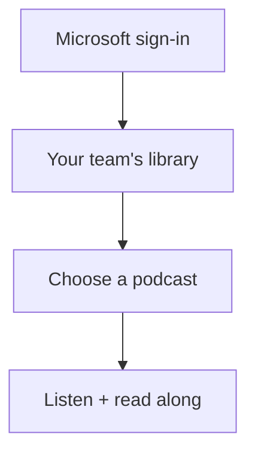
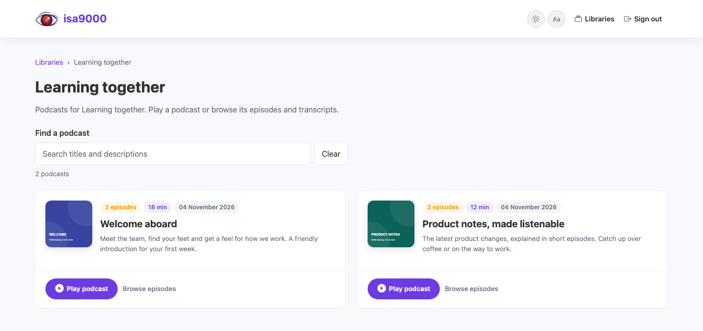

  <picture>
    <source media="(prefers-color-scheme: dark)" srcset="https://raw.githubusercontent.com/AlexandruGirlea/isa9000/main/docs/assets/img/isa9000-hero-dark.png">
    
  </picture>

<h1 align="center">isa9000-ops</h1>

  <strong>The engine behind Dev Stories. Your knowledge. Your brand.</strong>

  Give your employees a company audio library they can listen to over coffee, 
  on a walk, or between meetings. Run it in your own Azure environment.

  <a href="https://alexandrugirlea.github.io/isa9000-ops/"><strong>Documentation</strong></a>
  ·
  <a href="docs/getting-started.md">Installation guide</a>
  ·
  <a href="docs/branding.md">Make it yours</a>
  ·
  <a href="https://devstories.eu">Hear Dev Stories</a>
  ·
  <a href="https://github.com/AlexandruGirlea/isa9000">Meet the engine</a>

**Your company already has the knowledge. Give people another way to enjoy it.**
Turn onboarding material, product updates and team handbooks into short,
fact-checked podcasts, with transcripts employees can read along with.

isa9000-ops is **white-label software you operate**: replace the name, logo and
colors with your own. Employees sign in with their Microsoft work account and
listen to podcasts shared with their teams. Creators work in the browser too.
Administrators can deactivate accounts. Sessions allow two hours of inactivity
and up to eight hours before signing in again; listening counts as activity.
Audio, covers and transcripts require authorized application access on every request.
Azure deployments include Key Vault and encrypted worker messages. IT connects the
application to its approved network using the [client networking guide](docs/networking.md).
Local settings use `ISA9000_` names in exported shell variables or ignored `.env`;
only the blank `.env.example` belongs in git.
The public source includes generic deployment templates only. Keep actual stack
settings, credentials, state and local tooling metadata in your private deployment
workspace; ignoring files does not remove them from a folder or Git history.

It uses [isa9000](https://github.com/AlexandruGirlea/isa9000), the engine behind
[devstories.eu](https://devstories.eu). Dev Stories shows the listening experience;
ops adds company sign-in, group libraries and deployment tooling.

## From first look to your first podcast

| Step | Who | What happens |
|---|---|---|
| **1. Get your copy** | IT | Clone the source for a local trial; keep a company-controlled repository for Azure deployment. |
| **2. Connect and brand it** | IT + your team | Configure Microsoft sign-in, choose Azure/AI resources, and add your name and logo. |
| **3. Install and check** | IT | Run the local trial, then deploy and validate the Azure pilot. Approve production only after its requirements are met. |
| **4. Create and listen** | Employees | Creators add documents, review the podcast and publish it. Colleagues sign in and press play. |

**Start with the [installation guide](docs/getting-started.md).** It explains
what to download, which accounts you need, the commands to run, and how to
create your first podcast. Employees only need a browser; IT handles setup once.
Azure setup uses isa9000's [recommended model defaults](docs/getting-started.md#5-try-real-audio-with-approved-ai-services).

  <picture>
    <source media="(prefers-color-scheme: dark)" srcset="docs/assets/library-dark.png">
    
  </picture>
   
  <em>An example library with demonstration content. Your name and logo go here.</em>

## Your knowledge, your control

The application, database and podcast files run in your Azure environment.
Your organization manages access, retention, AI services and upgrades.
Audio and transcripts remain ordinary files you can keep and move.

There is no separate isa9000-operated service holding your library. You own the
installation and choose its direction as your needs change. Configured cloud
and AI services still process content under their own terms.

**Current availability:** the local pilot is implemented. Azure deployment
validation and a general company-domain production setup are still pending.
The guide distinguishes the working local journey from those rollout prerequisites.

## License and security

Original project code is licensed under [Apache-2.0](LICENSE), with attribution in
[NOTICE](NOTICE). Dependencies retain their own licenses; see
[third-party notices](THIRD_PARTY_NOTICES.md) and the
[licensing and security guide](docs/licensing-and-security.md).

Report vulnerabilities privately using [SECURITY.md](SECURITY.md).
[Contributions](CONTRIBUTING.md) follow the same project license and the
[Code of Conduct](CODE_OF_CONDUCT.md). No commercial support SLA is implied.

---

Developed by Isabela and Alex @ [girlea.ro](https://girlea.ro).
[Talk to us about your organization's pilot](https://girlea.ro).
