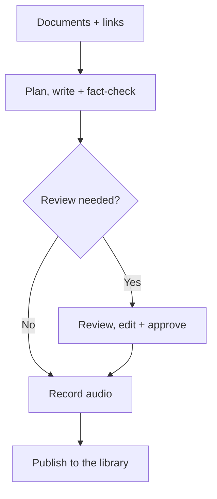
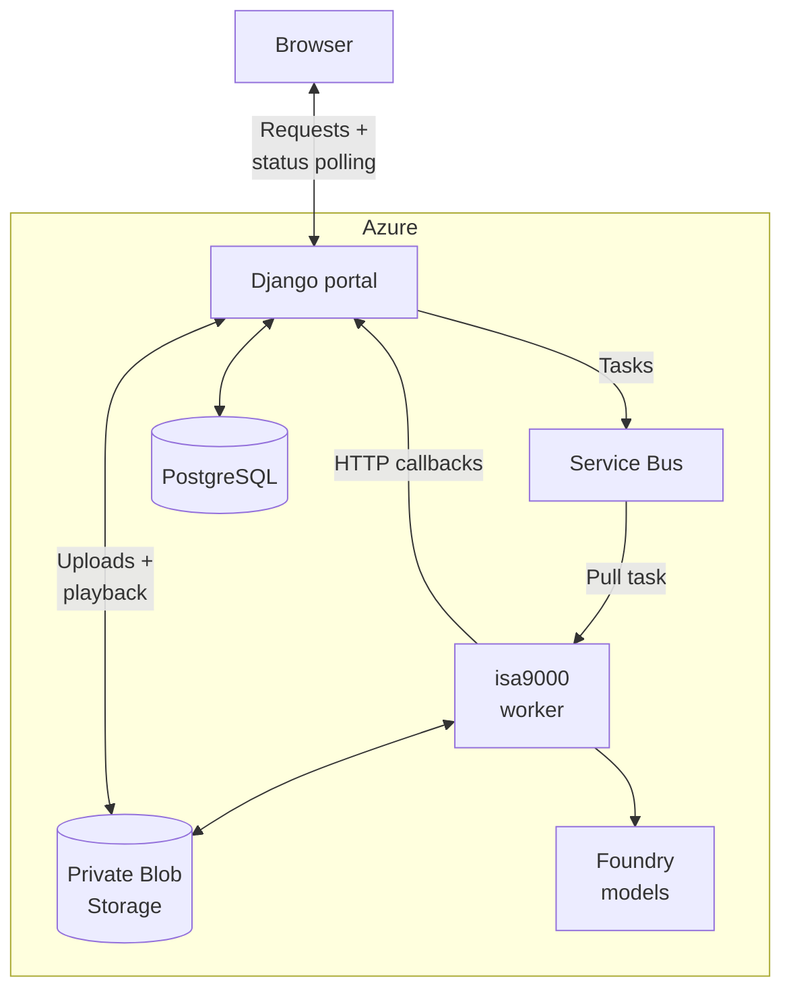
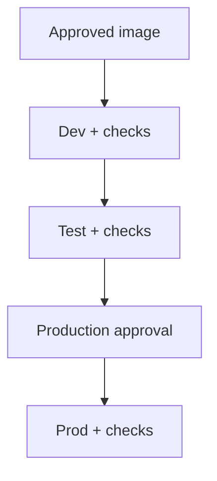

# One engine, your company's audio library

[isa9000](https://alexandrugirlea.github.io/isa9000/) plans, writes, fact-checks
and records podcasts. It is the engine behind [Dev Stories](https://devstories.eu).
isa9000-ops adds the shared browser app, Microsoft sign-in, group libraries and
Azure deployment tooling.

## From documents to listening

Creators can request transcript review; the engine's quality checks can also
require it. Only ready podcasts appear to listeners. Editing published transcripts
requires fresh approval and recording.

## What your organization runs

This shows the main generation path. Entra authenticates employees; Django
checks access and owns libraries, podcast pages and run history. Workers report
progress and results back to Django. Each worker replica handles one task at a time.

Service Bus carries tasks. Workers send progress and results directly to Django
through HTTP callbacks, and Django saves them in Postgres. While a run is active,
the browser polls Django for JSON updates about every 1.5 seconds.

For playback, Django checks group access and streams the file, including byte
ranges for seeking. It issues no shareable storage links. Removing access blocks
new media requests; already downloaded bytes cannot be recalled.
Application Insights follows requests, queue tasks
and callbacks through a common correlation ID.

Source documents and podcast files are in your Blob Storage; application records
are in Postgres. The configured AI services receive the content needed for
generation, under their own service terms. Public source links are fetched by
the worker; upload documents that require internal access.

## A deliberate release path

A company copy uses a published image pinned by digest. The upstream workflow
builds and publishes it; the company controls when to adopt it. With its own Azure
Container Registry, a company copy's release workflow instead builds, tests and scans
the image, then deploys that digest to every environment. Environment reviewers
provide approval gates.

The application uses Django and a stateless worker in one image. No separate
engine deployment, Celery or Redis is required. See the
[Azure guide](azure.md) for the setup sequence and current rollout limits.
