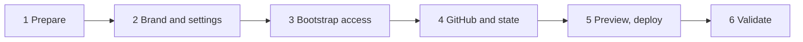

# Give employees a shared company URL

IT's six-step sequence to deploy isa9000-ops on Azure behind one company web address.

- Complete the [local trial](getting-started.md) first.
- Employees only use the resulting web address. They do not use GitHub or install the software themselves.

| Page | What you do |
| --- | --- |
| [Before provisioning](azure/before-provisioning.md) | What the supplied stack provides, where it stops, and enterprise requirements. |
| [Resource defaults and Key Vault](azure/resource-defaults.md) | Production sizing, network ranges, dev/test profile and Key Vault. |
| [Step 1: Prepare repository and accounts](azure/step-1-prepare.md) | Create the company GitHub copy and gather the accounts IT needs. |
| [Step 2: Brand and stack settings](azure/step-2-settings.md) | Fill in the per-environment stack settings from the example file. |
| [Step 3: Bootstrap Azure access](azure/step-3-bootstrap.md) | Create the Pulumi state storage and deployment identities. |
| [Step 4: GitHub and Pulumi state](azure/step-4-github.md) | GitHub environments, variables and secrets, and Pulumi stack initialization. |
| [Step 5: Preview and deploy](azure/step-5-deploy.md) | Preview the changes, get approval, then tag a release. |
| [Step 6: Validate with people and documents](azure/step-6-validate.md) | Acceptance checks with real users before promotion. |
| [Updates and day-to-day operation](azure/updates.md) | Promote new releases through the same environments. |
