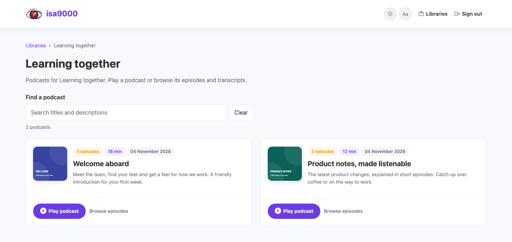

  <picture>
    <source media="(prefers-color-scheme: dark)" srcset="https://raw.githubusercontent.com/AlexandruGirlea/isa9000/main/docs/assets/img/isa9000-hero-dark.png">
    
  </picture>

# Your company's knowledge, ready to listen.

An onboarding series for the first week. Product updates on the walk to work.
A team handbook that fits into the day. **isa9000-ops gives your business its
own audio learning space, with its own name, logo and Microsoft sign-in.**

Built on [isa9000](https://alexandrugirlea.github.io/isa9000/), the engine behind
[Dev Stories](https://devstories.eu). Listen there to get a feel for the format,
then bring your own documents, audience and brand.

[Start your installation](getting-started.md){: .btn .btn-primary .mr-2 }
[Hear Dev Stories](https://devstories.eu){: .btn }

  

## Four steps to your team's audio library

1. **Get a company copy.** IT downloads the source and tries the browser app locally.
2. **Make it yours.** Choose a name and logo, connect Microsoft sign-in, and agree
   on Azure resources and approved AI services.
3. **Install and validate.** IT deploys to Azure and checks sign-in, access and
   podcast generation with your team before rollout.
4. **Publish your first podcast.** Creators add documents, review and publish;
   employees open the company URL and listen.

The business team chooses the content and audience. IT handles the installation
and ongoing operation. Employees install nothing.

## White-label means your brand

Call it *Contoso Learning*, *The Team Briefing*, or something only your team
would come up with. Your logo, colors and name appear across the portal and
podcast pages. The footer simply says **Powered by isa9000** by default; please keep
it, though it is optional.

[Set your name, logo and colors →](branding.md)

## You run it. You control it.

Your organization administers the application, database and podcast storage in
its Azure environment. Entra groups govern library access. You choose the AI
services, retention settings and application upgrades; audio and transcripts
remain ordinary files.

Self-hosting avoids adding a separate podcast SaaS service to hold your library.
Your configured cloud and AI services still process content under their own
terms. [See the architecture and data flow →](architecture.md)

## Start with a pilot

Try the app locally with a small set of documents and a pilot audience, then use
your Azure environment for a shared installation.

The [installation guide](getting-started.md) covers local setup, Azure deployment
and checks for your organization's rollout. The [Azure guide](azure/before-provisioning.md)
describes the supplied infrastructure and network integration options.
[Talk to us](https://girlea.ro) about planning your organization's pilot.
