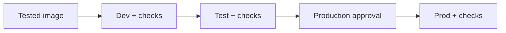

# Operator reference

Application behavior and operating details for IT. New installations start with
[Install and get started](getting-started.md), then [Install on Azure](azure.md).

## 1. Architecture

Application code lives in `services/`: `worker/` runs the installed isa9000
library, `web/` contains Django, and `shared/` provides storage and telemetry.
The shared image is built from `services/Dockerfile`; its worker command is
`python -m worker`. The image is `services:local` locally and
`ghcr.io/alexandrugirlea/isa9000-ops:<version>` for releases.
The worker installs `isa9000==0.3.0` and invokes its CLI. Django owns users,
permissions, library navigation, saved runs and podcast HTML.

Content settings belong to each podcast; infrastructure settings belong to IT.
Click a podcast to follow its active run, review its transcripts, or listen once
it is ready. A title is required; a description is optional. **Edit podcast** on
the published player opens **Manage** for administrators and creators in the
owning library, including another creator's podcasts. They can update the title
(up to 80 characters), description and cover. Other libraries remain inaccessible.
Updating details or the cover rebuilds the published page without model calls;
existing audio stays the same.

Custom covers must be still JPEG, PNG or WebP images, square, 256–4096 pixels per
side and at most 5 MiB. Use 1024 × 1024 for best results; larger images are resized.
The browser previews valid files, and the server independently verifies and
re-encodes them, stripping metadata and trailing content. SVG, animations and
malformed images are rejected. Cover changes require a current revision and are
locked during active runs. The published cover stays available while its
replacement is rendered; the change is audited without logging image contents.

Administrators can open **Admin → Podcasts → a podcast → Additional libraries**
and select other libraries, then **Save**. Members of those libraries can listen
once the podcast is published. Sharing does not copy files or run generation, and
only creators in the owning library (plus administrators) can edit or manage it.
Clear a library from the selection to remove its access. New page/media requests
are denied immediately; already downloaded or buffered media cannot be recalled.
When review is needed, read transcripts in the on-page dialog, check the review
notes, and confirm **Approve & record audio**. Approval is audited and recording
publishes the completed audio to the library. The progress page offers the same
approval action and directs you to any newer active run.
The transcript dialog also offers **Edit transcript** when no run is active.
Saving requires fresh approval and preserves the previous files. Editing published
audio asks you to confirm removing the podcast from the listener library until it
is approved and recorded again; only changed episodes need new audio. Saving itself
makes no model calls. Earlier AI scores apply to the original draft, not your edits.
Concurrent edits and approvals from stale tabs are rejected. Transcript edits are
audited by actor, episode, time and correlation ID without logging transcript text.
Creators can choose narration and wording without access to model deployments,
credentials or another group's content. A run keeps a snapshot of those choices,
so reopening progress, retrying and recording after review use the same settings.
There is one account system (Entra), one source of directory membership (Entra
groups, optionally supplemented by audited local grants) and one application
database (Postgres).

See the [architecture overview](architecture.md) for the main generation path.

## 2. Pages

People see each enabled Entra group as a **library**.
Each library contains **podcasts**, each podcast contains episodes, and each
creation, recording or rendering attempt is a **run**. The standard Django
admin exposes **Libraries / Entra groups**, **Local library access**, **Podcasts**, **Runs** and
**Users**.

Optional podcast descriptions use the standard Vditor rich-text editor (up to
10,000 characters). Its toolbar offers visual editing, Markdown source, preview,
headings, emphasis, lists, checklists, tables, quotes, links, code and undo/redo.
CommonMark/GitHub-style Markdown, images by URL and footnotes are preserved.
Use `[Team handbook](https://example.com/handbook)` to link supporting documents.
The podcast page shows a short introduction; **Full description and resources**
expands longer content, tables, images and lists, keeping the player near the top. Document
links open in a new tab. Library cards show three-line title and description
previews; the player shows the complete title. Preview does not save or generate anything.
Document links keep the destination's own access requirements, such as SharePoint
sign-in, and are not fetched or used as generation sources automatically.

Preview and publication use the same locked `markdown-it-py` renderer, with raw
HTML disabled and HTTP/HTTPS reference links only. The browser editor, its parser,
icons and styles are served locally; no public CDN or browser draft storage is
used. Third-party notices are included beside the vendored assets. Vditor and
the Markdown parser are maintained open-source projects without formal LTS release
lines; Django stays on the 5.2 LTS line.

**Libraries** always opens the library list. It shows a card only when an
enabled library has podcasts visible to that user: membership in five libraries
with podcasts in two gives two cards. Viewers see ready podcasts; creators also
see drafts in their accessible libraries. Creators and administrators also see
empty libraries with **Show when empty** turned on. **Add podcast** lets creators
choose any named, enabled library they can access, including a hidden empty one.
Library and podcast pages show 24 cards per page, with server-side search.

The portal navbar shows **Libraries**, **History** for creators, and **Admin**
for administrators. Breadcrumbs follow **Libraries → group library → podcast**
and continue into management and progress pages. The portal reuses isa9000's
presentation templates and cards, with responsive navigation and a footer
that stays at the bottom on short pages.
Library and podcast search filters only the cards the person can already access.
Search stays in the browser; it does not store listening history or search terms.

**History** at `/runs/` lists podcasts you created, newest first, ten rows per
page. Each row shows its library, creation time and a colored status badge:
green for ready, purple for queued or in progress, amber for review, red for
failed and neutral for stopped or draft. Actions say **View progress** while
work is active, **Review transcripts** when approval is needed and **View result**
or **View details** after it finishes. Titles open the podcast; its management
page retains all individual runs and retries.

Internally the model remains `Course`, with `/courses/` URLs and `courses/`
blob paths. Those names are implementation contracts; the UI says **Podcast**.

Listeners follow **Sign in → Libraries → Library → Podcast**. Creators also have
creation, progress, review and management pages; administrators have **Admin**.

## 3. Sign-in and access

Entra ID handles sign-in. Django checks the groups in the person's token on
every request. Administrators are the members of one Entra group or people with
the local **Application administrator** flag, and they make people creators in the
admin. See [libraries and local access](#libraries-and-local-access).

The admin uses Django's standard layout. Administrators manage libraries and
viewer/creator roles under **Libraries** and **Users**. Roles persist across
sign-ins, and administrators are labelled **Administrator**.
Run results and **Activity** are read-only. Local sign-in uses real Entra tokens;
the configured admin group controls administrator access in every environment.
Anonymous protected requests go to sign-in. The only unauthenticated surfaces
are sign-in/OAuth endpoints, static assets and health; worker callbacks require
their separate bearer credential. Error pages are standalone and load no app UI.

New users start as viewers. Membership in the configured administrator group or the
local flag grants administrator access; other users retain their assigned viewer or
creator role. Ready podcasts are visible through their owning library or an
administrator's sharing grant. Drafts and management actions require creator access
to the owning library. Podcasts are unavailable while their owning library is not enabled.
Unauthorized requests return 404. Azure trusts Easy Auth's authenticated identity;
local Entra sign-in validates tokens directly.

Django's existing `User.is_active` flag is editable through **Admin → Users**.
New accounts default to active; identity/group synchronization never reactivates
a disabled user. Inactive accounts are refused on each protected request,
including requests made with an existing session.

### Libraries and local access

When a member signs in, each group in their token appears under **Admin → Libraries / Entra groups**,
named after its Entra group ID and set to **Hidden**. Open the group, change the name
and set the status to **Enabled**. Turn on **Show when empty** to list it before its first
podcast. Filter by status, display name, content and **Show when empty**, or
search by name or ID.

For a group nobody has signed in with yet, use **Add library** with its Entra group ID. With
`groupClaims: ApplicationGroup`, also assign the group to the application, or its members'
tokens will not list it.

| Library status | In the portal |
|---|---|
| **Hidden** | Nobody can use it in the portal: pages, media and shares return 404 for everyone, including administrators. All data is kept, and restoring is one status change. Runs already in progress still finish |
| **Enabled** | Available to members, local grants and administrators |

Names are labels: access always uses the Entra group ID. Administrators get every enabled library in the portal. Admin list sidebars
offer the first 50 enabled libraries; each library's page links to its people and podcasts.

If you roll back to a release before this one, podcasts created in new groups stay hidden
after you upgrade. Find them with the **Hidden** status and **Owned podcasts** content
filters, then enable those libraries.

| Enabled library | Viewer | Creator with access | Administrator |
|---|---|---|---|
| Has podcasts visible to that person | Published podcasts | Drafts and published podcasts | Drafts and published podcasts |
| Empty, **Show when empty** off | Hidden | Hidden, but offered in **Add podcast** | Hidden, but offered in **Add podcast** |
| Empty, **Show when empty** on | Hidden | Visible | Visible |

Published podcasts shared into a library count as its content. **Show when empty**
grants no membership or creator rights.

**Admin → Local library access** gives one person access to one enabled library
without changing Entra. Each record keeps who granted it, the time, an optional reason,
an optional expiry and any revocation. Without an expiry, access lasts until it is revoked. Records can be revoked but not edited or deleted.
A person's access is their current Entra membership
plus active local grants, and **Admin → Users → the person** shows each source.
Revoking a local grant cannot remove access that Entra still provides. A local grant
never changes the viewer/creator role, and it never makes anyone an administrator, even
when the library's group is the administrator group.

### Group overage

Entra leaves the group list out of a token when a person is in too many groups (above
200 for these tokens) and sends an overage indicator instead. Such a person can still
sign in, but the application cannot read their groups: it never calls Microsoft Graph
and never follows URLs from the token. Their last known memberships are kept for
diagnosis only and grant nothing. They see a notice with a reference ID. Find them under
**Admin → Users** with the **Directory membership** filter and give them local library
access. A token with a missing or unreadable group list is handled the same way. An
explicit empty list is a complete answer: that person simply has no Entra libraries.

Restricting claims to groups assigned to the application (`groupClaims:
ApplicationGroup`) reduces overage, subject to Microsoft's licensing and nesting limits.

### Administrator access and recovery

A person is an administrator while their token lists the configured administrator group
or their **Application administrator** flag is set under **Admin → Users**. Both are
checked on every request, so a change applies on the person's next request, not at their
next sign-in. An administrator affected by overage has no token evidence and needs the
flag. Administrators can set the flag and **Active** for other people but not for
themselves, and changes are audited. Suspended people stay blocked whatever their flag.

If nobody can reach the admin, an operator with access to the web container can restore
one identity. The command requires this deployment's tenant ID and the person's Entra
object ID, and works before their first sign-in. Add `--activate` to also reactivate a
suspended account. `az containerapp exec` needs an interactive terminal and cannot pass
arguments through `--command`, so open a shell first:

```bash
az containerapp exec --resource-group YOUR-GROUP --name YOUR-WEB-APP --command sh
```

Then, inside that shell:

```bash
python manage.py app_admin grant --tenant TENANT-ID --object-id OBJECT-ID
```

Use `app_admin revoke` the same way. Activity shows these changes as **Operator command**.

Application sessions use a two-hour idle timeout and an eight-hour absolute limit.
Successful navigation/actions and CSRF-protected playback/activity heartbeats
update the idle timestamp. JSON progress polling and idle tabs do not. The
heartbeat is included on portal, admin and saved podcast pages. Local Entra
sessions keep the MSAL token cache on the server and refresh expired ID tokens;
signature, issuer, audience, tenant and identity are still verified. Expired or
unrefreshable credentials require sign-in. Fake sessions follow the same timeouts.
The Azure template sets Easy Auth's cookie lifetime to eight hours; applying that
setting requires the normal approved deployment. Microsoft policy can end a
session earlier. See [Create and listen](using.md#staying-signed-in).

## 4. Creating a podcast

The creation form and progress page reuse styles from isa9000's packaged
generation UI. The form submits to Django, which checks group permissions,
validates public HTTP/HTTPS source URLs and uploads, and queues the worker.
The worker fetches source contents and invokes the installed library.

The hosted CLI adapter enforces public-address checks at fetch time, including
every redirect and linked page, and pins each connection to a validated IP while
verifying the original TLS hostname. It bounds redirects, response size and time,
and sends no deployment credentials, ambient proxy settings or cookies to source
websites. Sources use standard HTTP/HTTPS ports; compressed responses are refused
after requesting an uncompressed response. Use uploads for internal documents.
The adapter preserves source references and changes no engine files. Its hooks
into the pinned library's source modules must be revalidated on upgrades.

The form follows four decisions: describe the audience and outcome, add sources,
choose the narrator and wording, then choose whether to review transcripts first.
Voice, narrator name, pronunciation entries, greetings, endings and quality start
with the organization's defaults and are saved for that podcast. Provider,
models, credentials, paths, fact-checking and brand identity remain controlled by
the deployment configuration.

**Review transcripts before recording** is selected by default and creates a private draft.
Read the transcripts and review notes, then select **Approve & record audio** to publish
it to the library. Without that option, a successful generation records and
publishes automatically. Engine review failures still stop for review. Viewers
only see ready podcasts. Saved settings follow recording and retries, and the
shared configuration is never rewritten by a creator.
**Cancel processing** asks for confirmation, then stops the run and deletes any transcripts
and recordings it created. It cannot be resumed; **Retry** starts again. Existing transcripts
and published audio stay, and uploaded source documents stay until they expire. History shows
**User canceled**, and the run page shows who did it.

Progress shows saved steps, elapsed time and Cancel/Retry controls. When a run fails, creators
see a short message and a reference; administrators find the full error and activity log under
**Admin → Runs**.
While queued or running, the browser polls Django every 1.5 seconds;
leaving and reopening the page restores the saved progress. This is JSON
polling, not a streaming connection to the CLI. The local FastAPI generation
app is not hosted as a separate service.

1. Django checks permissions, saves uploads and queues a task with its trace context.
2. A worker receives the task and asks Django to accept the queued run. Only an
   accepted run proceeds; the worker completes the queue message before generation.
3. The worker downloads sources, runs isa9000 and sends progress and heartbeats.
4. It uploads the results and reports `ready`, `needs_review`, `failed` or `stopped`.
   Only a ready result includes the published podcast HTML. The browser polls Django
   for saved progress throughout.

Runs and podcasts have separate statuses. Every task makes a new run, and a
run ends once.

A run starts `queued`, becomes `running` when accepted, and ends once as `ready`,
`needs_review`, `failed` or `stopped`. Queued runs can also fail or stop before pickup.
The watchdog fails runs with no worker after 15 minutes or no heartbeat for 5 minutes.

A podcast starts `draft`. Successful creation makes it `ready` or `needs_review`;
recording approved transcripts makes it `ready`. Editing published transcripts returns
it to `needs_review` until approved and recorded again. A render updates its page.
Failed or canceled runs do not change the podcast's status.

## 5. Deleting an episode

Django deletes a whole podcast's files and database rows. Episode deletion depends
on whether the remaining episodes have published audio:

Django removes the selected episode's audio, transcript and manifest entry. For a
published podcast with audio remaining, it queues a render task; the worker rebuilds
the page and returns its HTML. A draft remains in review without a render task.
Removing the final episode deletes the podcast.

## 6. The worker

The worker has no database and keeps nothing between runs. It takes a task,
runs isa9000, uploads the files, sends back the podcast page and exits. It scales
out with one container per task.

1. Receive one queue message, waiting up to 30 seconds; exit if there is none.
2. Ask Django to accept the run. A duplicate or inactive run is completed and skipped.
   Failed acceptance abandons the message for redelivery; the queue dead-letters it
   after its delivery limit.
3. Complete an accepted message, start heartbeats, then download inputs and run the
   requested `create`, `record` or `render` task.
4. Upload available results, render the page when ready, report the outcome and exit.

Because the message is completed before execution, a worker crash after acceptance
is detected by the watchdog; a user retry creates a new run.

## 7. Tracing with Application Insights

One correlation id, the W3C trace id, follows each request from the click to
the result. In Application Insights, **Transaction search** for that id shows
the whole trail. People see the same id as the reference on run and error
pages.

**Activity** shows who created or changed an object, when, which fields changed
and its correlation ID. Structured audit events also go directly to Application
Insights and container stdout, independently of PostgreSQL. They cover sign-in,
logout, denied access, admin page access and mutations, course changes, dispatch
and worker outcomes. A `pending_commit` event records an attempted change;
`success` is emitted only after its database transaction commits. Actor IDs are
Entra object IDs; names, emails, source content and OAuth codes are excluded.

Telemetry uses managed identity with Monitoring Metrics Publisher access scoped
to the Application Insights resource. Local-key ingestion is disabled, with
100% sampling. Retention defaults to 365 days in prod and 30 days in dev/test.
**Admin → Contact requests** lists messages from creators. Everything is read-only except the
status, and changing it records who did so and when.

**Admin → Activity** records who created, edited, shared, canceled and deleted what, and each
podcast shows who last edited it. Administrators can read these records but not add, change or
delete them, and a PostgreSQL trigger refuses updates and deletes. A database owner can still
remove that trigger, so this is not a tamper-proof ledger.

Application Insights is independent of database edits, but it is not an immutable
ledger: Azure administrators control retention and purge permissions. Direct SQL
changes bypass application auditing. Azure ingestion and access controls still
need validation in an approved deployment.

Use [infra/audit.kql](https://github.com/AlexandruGirlea/isa9000-ops/blob/main/infra/audit.kql) in the Log Analytics workspace to inspect
the audit trail. The infrastructure includes an alert for more than five denied
sign-ins, admin requests or worker callbacks in five minutes, alongside run,
server-error and dead-letter alerts.

The web request starts the trace, the queued task carries `traceparent`, and the
worker and its callbacks continue it. The run stores the same correlation ID so
operators can find the matching spans and audit events.

## 8. Releases

One `v*` tag deploys dev, then test, then prod. Prod needs an approver, and it
can't run unless dev and test passed in the same run.



The upstream tag workflow builds, scans and publishes the image first. An organization's
copy uses its configured image instead. A failed deployment or check stops promotion;
production approval requires the GitHub environment protection described below.

---

## 9. Run locally

Follow [the local installation walkthrough](getting-started.md) for cloning,
Entra registration, configuration, real audio and the first podcast.

Use a separate browser profile and a real Entra employee account to check group
isolation. For local UI checks, `make fake-user` creates a numbered viewer and
prints a session cookie with a two-hour idle timeout and eight-hour maximum;
`make fake-user n=3` issues a fresh session for that account.
Fake sessions cannot become administrators and deployed Easy Auth rejects them.
Treat cookie values as credentials. `make local-user` and `make seed` are legacy
fixtures requiring explicit dev mode.

`make help` lists commands. `make scale n=3` starts three workers,
`make logs s=worker` follows logs, `make test` runs ruff and pytest, and
`make check` checks production settings. `make down` keeps data;
**`make clean` deletes the local database, blobs and queue volumes.**
Emulator messages do not survive restarts, and message TTL is limited to an hour.

The image uses UID 10001. Source and branding are mounted locally; Python changes
reload. The watchdog checks every five minutes. Azure startup migrations use a
PostgreSQL advisory lock to serialize changes across replicas.

The optional `local/models.py` provisioning helper requires `--resource-group`
and a private `local/foundry/Pulumi.local.yaml` with an `isa9000:models` list.
Each model entry needs `role`, `name`, `model`, `version`, `format`, `sku` and
`capacity` supplied by your AI platform team. Use `preview` before approving
`up`; provisioning creates billable Azure resources. Private state and credentials
are stored outside the source folder. Keep the actual stack file private too.

Microsoft [does not support SQL Server under CPU emulation](https://learn.microsoft.com/sql/linux/install-upgrade/setup).
Apple Silicon requires x86 emulation for the emulator's SQL Server dependency.
Compose accepts Microsoft's Service Bus and SQL Server EULAs through
`ACCEPT_EULA=Y`. See [Microsoft's emulator setup](https://learn.microsoft.com/azure/service-bus-messaging/test-locally-with-service-bus-emulator).

## 10. Make it yours

Follow [Make it yours](branding.md). Azure expects `config/logo.svg`; the brand
TOML must not include model mappings or credentials. A locally configured
`ISA9000_CONFIG_FILE` overrides the file from `config/`.

## 11. Bootstrap and secrets

Follow the [Azure installation sequence](azure.md), including company repository
setup, stack configuration, bootstrap, GitHub environment values and promotion.

If IT supplies an existing sign-in registration, configure `isa9000:authApp`
with its `clientId`; the workflow injects `clientSecret` from the environment
secret `AUTH_CLIENT_SECRET`. Register both
`https://YOUR-APP-HOST/.auth/login/aad/callback` and `https://YOUR-APP-HOST/` as web
redirect URIs: Microsoft returns people to the landing page after sign-out only if it is
registered. Enable ID-token issuance for Easy Auth and configure the selected group claims. Use a separate registration
per environment. The local callback is different.

For PR previews, create a protected GitHub environment named `preview` with a
required reviewer. After configuring it, set the repository-level variable
`ENABLE_AZURE_PREVIEW=true`; previews are skipped by default in a new checkout.
Set its `AZURE_CLIENT_ID` to the preview identity, along with
`AZURE_TENANT_ID`, `AZURE_SUBSCRIPTION_ID`, `PULUMI_BACKEND_URL=azblob://pulumi-dev`,
`PULUMI_STACK_CONFIG` (the dev stack file) and `AZURE_STORAGE_ACCOUNT`. Its only
state secret is
`PULUMI_DEV_CONFIG_PASSPHRASE`, a copy of the dev environment's passphrase.
Preview runs only for same-repository branches, excluding Dependabot. Review the
PR's code before approving access to dev secrets; prod secrets are never supplied.
Reader-only preview permissions still need Azure validation because some
providers read resource keys.

The deployment workflow only accepts calls from the tag-triggered release
workflow. Upstream publishes an image and GitHub build provenance; a company
copy uses its configured image. GitHub environment protection supplies the
approval gates. Back up private Pulumi state and its passphrase.

Each stack creates a Key Vault in its own resource group. It stores the database
connection, Django key, callback secret, admin group, Entra application secret
and payload key. References use each workload's managed identity and the following
secret-level grants; no workload receives vault-wide Secrets User access.

| Workload | Secrets it may read |
|---|---|
| Django web | `database`, `django-key`, `callback`, `admin-group`, `auth-client-secret`, `payload-key` |
| Django watchdog | `database`, `django-key`, `admin-group` |
| Worker | `callback`, `payload-key` |

Service Bus uses TLS and callbacks use HTTPS in Azure. Task bodies, callback bodies
and successful replies additionally use AES-256-GCM with the same per-environment
256-bit key, a fresh nonce, and authenticated direction/run/action context.
Plaintext, modified messages and messages used for another run/action are rejected.
Run-state checks still handle duplicate deliveries. Routing and correlation IDs
remain visible; generic non-success responses contain no confidential payload.
The CLI subprocess does not inherit the key. Callbacks retain an 8 MiB plaintext
limit with a bounded larger envelope allowance for encryption overhead.

Azure resolves the Key Vault references; application code receives environment
variables and does not need another Key Vault client. Public branding/model TOML
and logos remain inline configuration assets. Secret values still exist in
encrypted Pulumi state, and processes authorized to use a secret can see it.
Key Vault does not protect a secret from a compromised process that already holds it.

Before upgrading to encrypted messaging, pause new runs and drain queued/running
work, then update web and worker together. Old plaintext queue messages are rejected.
For local development, run `python3 local/configure.py` to persist the random local
payload key, then recreate web and worker after work has drained. Do not regenerate
it independently on either side. Local emulators do not use Azure Key Vault.
Local settings use `ISA9000_` names. Exported shell values take precedence over
ignored `.env`; setup does not copy exported secrets back into that file.
Only the blank `.env.example` belongs in git.

Versionless references support new secret versions, but rotation must be coordinated:
drain jobs, update the credential producer and all consumers, verify propagation,
then resume. Database passwords, callback keys and Django keys have different
availability/session consequences. Manage generated values through Pulumi; ad hoc
vault edits can be overwritten by a later deployment. Microsoft's
[reference and rotation documentation](https://learn.microsoft.com/en-us/azure/container-apps/manage-secrets#key-vault-secret-uri-and-secret-rotation)
describes propagation behavior. Audit events go to the existing Log Analytics
workspace; no secret values are logged.

Vault purge protection retains deleted vaults/secrets for 90 days. Routine deploy
identities can create/update native secret resources through ARM, but the pinned
provider uses data-plane operations for deletion/recovery. An approved teardown
or recovery therefore needs a separately authorized operator; do not broaden
worker permissions or disable production protection to make cleanup succeed.
See [client networking](networking.md) for the independent database/network boundary.

## 12. Deployment status

The portal, worker and infrastructure have local automated coverage, including group
permissions, review and editing, callbacks, source fetching and mocked cloud resources.
Local browser checks have exercised the listener and creator flows at mobile and
desktop widths. These checks do not establish real model quality, production readiness
or real-device background playback.

The local stack supports Entra sign-in and real Foundry generation when configured.
A completed Azure application deployment is still pending. Before promotion, validate
Easy Auth claims, worker callback routing, managed identities, secret mounts, queue
scaling, media access and tracing in dev. Run the current image scan and an approved
real generation with your organization's model deployments.

The public Azure pilot is implemented. Client deployments use Azure end to end;
their network ownership, inactive Pulumi examples and integration steps are in
[Client networking](networking.md). Internal ingress, private Postgres, custom domains
and provided certificates need that integration before use. Postgres currently uses
the pilot's Azure-services firewall exception. Clients configure rate limits at their
Azure gateway/WAF.

Public smoke tests check availability, not the served version; internal checks inspect
the latest revision's health and image. Verify preview-provider permissions without
silently expanding the read-only identity's access.

## Publishing these docs

The documentation uses the same `just-the-docs@v0.10.1` theme and palette as
isa9000. After the docs are present on GitHub, select **Settings → Pages →
Deploy from a branch → main → /docs**. This matches isa9000's publishing setup.
[GitHub's Pages instructions](https://docs.github.com/en/pages/getting-started-with-github-pages/configuring-a-publishing-source-for-your-github-pages-site)
describe the account/plan requirements.

The site URL is `https://alexandrugirlea.github.io/isa9000-ops/`.
Publishing these static instructions does not install the employee application,
publish an image or deploy Azure. Keep private company content out of the site.
