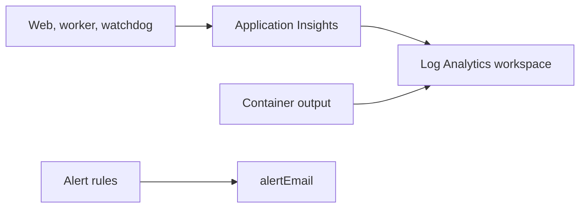

# Monitoring and tracing

Trace requests, read audit events and find logs and alerts for each environment.



## Trace IDs

- **One correlation ID**, the W3C trace id, follows each request from the click to the result.
- **Transaction search** in Application Insights for that id shows the whole trail.
- **Run and error pages** show the same id as the reference.
- **Propagation:** the web request starts the trace, the queued task carries `traceparent`, and the worker and its callbacks continue it.
- **The run** stores the same correlation ID, so operators find the matching spans and audit events.

## Audit events

- **Activity** shows who created or changed an object, when, which fields changed and its correlation ID.
- **Destinations:** structured audit events also go directly to Application Insights and container stdout, independently of PostgreSQL.
- **Coverage:** sign-in, logout, denied access, admin page access and mutations, course changes, dispatch and worker outcomes.
- **`pending_commit`** records an attempted change; `success` is emitted only after its database transaction commits.
- **Actor IDs** are Entra object IDs. Names, emails, source content and OAuth codes are excluded.
- **Query:** use [infra/audit.kql](https://github.com/AlexandruGirlea/isa9000-ops/blob/main/infra/audit.kql) in the Log Analytics workspace to inspect the audit trail.

> **Warning:** Application Insights is independent of database edits, but not an immutable ledger. Azure administrators control retention and purge permissions. Direct SQL changes bypass auditing. Verify Azure ingestion and access controls as part of your deployment checks.

## Admin pages

- **Admin → Contact requests** lists messages from creators. Everything is read-only except the status; changing it records who did so and when.
- **Admin → Activity** records who created, edited, shared, canceled and deleted what. Each podcast shows who last edited it.
- **Activity access:** administrators can read records but not add, change or delete them. A PostgreSQL trigger refuses updates and deletes.

> **Note:** The application's database role cannot remove that trigger, but the database administrator can. It is not a tamper-proof ledger.

## Telemetry settings

- **Auth:** managed identity with Monitoring Metrics Publisher access scoped to the Application Insights resource.
- **Local-key ingestion:** disabled.
- **Sampling:** 100%.
- **Retention:** defaults to 365 days in prod and 30 days in dev/test.

## Alerts

- **Audit alert:** more than five denied sign-ins, admin requests or worker callbacks in five minutes.
- **Other alerts:** run, server-error, worker-executions and dead-letter alerts, alongside the audit alert.
- **Rule set:** five alert rules in total; see the portal section below.

## Where to find logs in the Azure portal

Everything below is in the environment's application resource group (the
`isa9000:resourceGroup` value in its stack settings), and resources are named
`isa9000-<environment>-<purpose>`. Portal menus change over time; every left-hand
menu has a search box, so typing a name from the trees jumps straight to it.

```
portal.azure.com
└─ top search bar → Resource groups → the application resource group
   └─ Overview = every resource in the environment
      (use "Filter for any field…" or the Type column to find one)
```

**1. Application Insights** (`isa9000-<environment>-insights`) is Azure's application
monitoring service; it receives requests, log lines, exceptions and audit events from
the web app, worker and watchdog.

```
Resource group → Overview → Application Insights
└─ left menu
   ├─ Investigate
   │  ├─ Failures            errors grouped by type; click one for details
   │  ├─ Transaction search  every request, log line and exception; paste a run's reference ID
   │  └─ Application map     web app, worker and database; red marks a problem
   └─ Monitoring
      └─ Logs                query box: double-click a table such as traces, then Run
```

**2. Log Analytics workspace** (`isa9000-<environment>-logs`) is Azure's log store and
query tool; it keeps the Application Insights data and the raw container logs together.

```
Resource group → Overview → Log Analytics workspace
└─ left menu → General → Logs
   ├─ close the Queries pop-up
   ├─ top right: if you see a point-and-click builder, switch to KQL mode
   ├─ top: Time range → for example Last hour
   └─ paste a query → Run
      ├─ AppTraces                   app log lines and audit events
      ├─ AppExceptions               errors and stack traces
      ├─ AppRequests                 web requests and status codes
      ├─ ContainerAppConsoleLogs_CL  raw container output
      └─ ContainerAppSystemLogs_CL   platform events such as restarts and job failures
```

For example, `AppTraces | order by TimeGenerated desc | take 100`. The audit query
above runs here too.

**3. Web app** (`isa9000-<environment>-web`) is an Azure Container App, a managed
container host; it serves the Django site and streams its output live.

```
Resource group → Overview → the web Container App
└─ left menu → Monitoring
   ├─ Log stream   live output: Console is the app, System is the platform
   ├─ Logs         the same query box as the workspace
   └─ Metrics      CPU, memory and request charts
```

Log stream needs a running replica; the web app always keeps at least one. The worker
(`isa9000-<environment>-worker`) is a Container App too, with the same menu.

**4. Container Apps Jobs** (`isa9000-<environment>-watchdog` and `-migrate`) run a
container once and exit: the watchdog every five minutes and the database migration
during a deployment.

```
Resource group → Overview → the watchdog or migrate Job
└─ left menu → Execution history
   └─ one row per run: Succeeded, Failed or Running, with its start time
      └─ click a failed run → its console and system logs
```

A job with no rows has not run recently.

**5. Azure Monitor alerts** (`isa9000-<environment>-<rule>`) watch the logs and queue
metrics and email the `alertEmail` address when a rule fires. The address must be
verified first; see [Install on Azure](../azure/step-6-validate.md).

```
Resource group → left menu → Monitoring → Alerts
├─ main page                alerts that fired: set the Time range, click one for details
├─ top bar → Alert rules    the five rules being watched
│  ├─ failed-runs           runs that failed
│  ├─ server-errors         web app server errors (HTTP 5xx)
│  ├─ denied-access         denied sign-ins, admin requests or worker callbacks
│  ├─ worker-executions     a worker container crashed or could not start
│  └─ dead-letters          queue messages that were dead-lettered
└─ top bar → Action groups  who gets the email (the alertEmail address)
```
