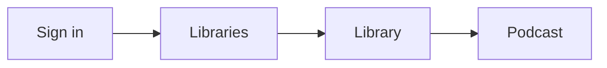

# Pages

Reference for portal pages, library and podcast lists, search, History and podcast descriptions.

Creators also have creation, progress, review and management pages. Administrators have **Admin**.

## Glossary

| Term | Meaning |
|---|---|
| **Library** | An enabled Entra group, as people see it |
| **Podcast** | Belongs to a library |
| **Episode** | Belongs to a podcast |
| **Run** | One creation, recording or rendering attempt |

## Pages and navigation

| Page | Who sees it | What it does |
|---|---|---|
| **Libraries** | Everyone | Always opens the library list |
| **History** (`/runs/`) | Creators | Lists podcasts you created |
| **Admin** | Administrators | Standard Django admin |

- **Navbar:** **Libraries**, **History** (creators), **Admin** (administrators).
- **Breadcrumbs:** **Libraries → group library → podcast**, continuing into management and progress pages.
- **Admin models:** **Libraries / Entra groups**, **Local library access**, **Podcasts**, **Runs**, **Users**.
- **Layout:** reuses isa9000 presentation templates and cards; responsive navigation; footer stays at the bottom on short pages.

## Library list rules

- **Viewers** see a card only when an enabled library has a ready podcast.
- **Example:** membership in five libraries with podcasts in two gives two cards.
- **Creators and administrators** see every enabled library they can access, including empty ones and drafts.
- **Add podcast** lets creators choose any enabled library they can access.
- Library and podcast pages show 24 cards per page.

## Search

- Server-side search on library and podcast pages.
- Filters only cards the person can already access.
- Search stays in the browser; no listening history or search terms are stored.

## History

Lists podcasts you created, newest first, ten rows per page. Each row shows library, creation time and a status badge.

| Color | Status |
|---|---|
| Green | Ready |
| Purple | Queued or in progress |
| Amber | Review |
| Red | Failed |
| Neutral | Stopped or draft |

| Action label | When |
|---|---|
| **View progress** | Work is active |
| **Review transcripts** | Approval is needed |
| **View result** / **View details** | After it finishes |

- Titles open the podcast.
- Its management page retains all individual runs and retries.

## Podcast descriptions

- **Editor:** standard Vditor rich-text editor, optional, up to 10,000 characters.
- **Toolbar:** visual editing, Markdown source, preview, headings, emphasis, lists, checklists, tables, quotes, links, code, undo/redo.
- **Preserved:** CommonMark/GitHub-style Markdown, images by URL, footnotes.
- **Links:** use `[Team handbook](https://example.com/handbook)`. Document links open in a new tab.
- **Link access:** destinations keep their own access requirements, such as SharePoint sign-in; links are not fetched or used as generation sources automatically.
- **Podcast page:** short introduction; **Full description and resources** expands longer content, tables, images and lists. The player stays near the top.
- **Library cards:** three-line title and description previews. The player shows the complete title.
- **Preview:** does not save or generate anything.
- **Renderer:** preview and publication use the same locked `markdown-it-py` renderer; raw HTML disabled; HTTP/HTTPS reference links only.
- **Assets:** editor, parser, icons and styles are served locally; no public CDN or browser draft storage. Third-party notices sit beside the vendored assets.
- **Maintenance:** Vditor and the Markdown parser are open-source projects without formal LTS release lines; Django stays on the 5.2 LTS line.

## Internal naming

- The model remains `Course`, with `/courses/` URLs and `courses/` blob paths.
- These names are implementation contracts; the UI says **Podcast**.
