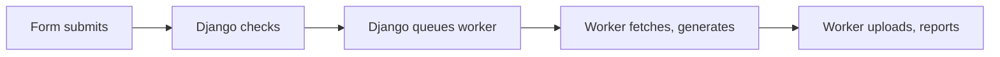
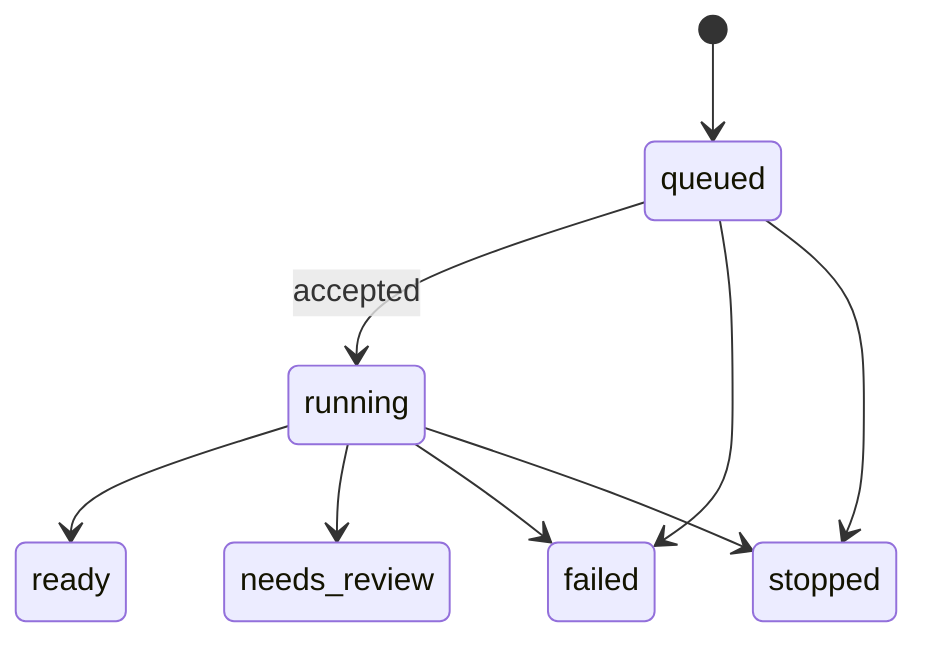

# Podcasts and the worker

How podcasts are created, run, canceled and deleted, and what the worker does at each step.

## Creating a podcast

The creation form and progress page reuse styles from isa9000's packaged generation UI.

1. The form submits to Django, which checks group permissions, validates public HTTP/HTTPS source URLs and uploads, saves uploads and queues a task with its trace context.
2. A worker receives the task and asks Django to accept the queued run. Only an accepted run proceeds; the worker completes the queue message before generation.
3. The worker downloads sources, runs isa9000 and sends progress and heartbeats.
4. It uploads the results and reports `ready`, `needs_review`, `failed` or `stopped`. Only a ready result includes the published podcast HTML. The browser polls Django for saved progress throughout.

The worker fetches source contents and invokes the installed library. The local FastAPI generation app is not hosted as a separate service.

### Source-fetch safety

The hosted CLI adapter:

- **Checks addresses:** enforces public-address checks at fetch time, including every redirect and linked page.
- **Pins connections:** pins each connection to a validated IP and verifies the original TLS hostname.
- **Bounds limits:** redirects, response size and time.
- **Sends nothing extra:** no deployment credentials, ambient proxy settings or cookies to source websites.
- **Ports:** standard HTTP/HTTPS only.
- **Compression:** requests an uncompressed response, then refuses compressed responses.
- **Internal documents:** use uploads.
- **Engine:** preserves source references and changes no engine files.

> **Note:** The adapter's hooks into the pinned library's source modules must be revalidated on upgrades.

### The form

Four decisions:

1. Describe the audience and outcome.
2. Add sources.
3. Choose the narrator and wording.
4. Choose whether to review transcripts first.

- **Per-podcast settings:** voice, narrator name, pronunciation entries, greetings, endings and quality start with the organization's defaults and are saved for that podcast.
- **Deployment-controlled:** provider, models, credentials, paths, fact-checking and brand identity.
- **Saved settings:** follow recording and retries. A creator never rewrites the shared configuration.
- **Pronunciations** can be edited later on **Manage**; the change applies the next time audio is recorded.

### Review, cancel and retry

- **Review transcripts before recording** is selected by default and creates a private draft.
- Read the transcripts and review notes, then select **Approve & record audio** to publish to the library.
- Without that option, a successful generation records and publishes automatically. Engine review failures still stop for review.
- Viewers only see ready podcasts.
- **Cancel processing** asks for confirmation, stops the run and deletes any transcripts and recordings it created.
- A canceled run cannot be resumed; **Retry** starts again.
- Existing transcripts and published audio stay. Uploaded source documents stay until they expire.
- History shows **User canceled**; the run page shows who did it.

### Progress

- Progress shows saved steps, elapsed time and Cancel/Retry controls.
- On failure, creators see a short message and a reference. Administrators find the full error and activity log under **Admin → Runs**.
- While queued or running, the browser polls Django every 1.5 seconds.
- Leaving and reopening the page restores the saved progress.
- This is JSON polling, not a streaming connection to the CLI.

## Statuses

Runs and podcasts have separate statuses. Every task makes a new run, and a run ends once.

- Queued runs can also fail or stop before pickup.
- **Watchdog:** fails runs with no worker after 15 minutes or no heartbeat for 5 minutes.

| Podcast status | Becomes |
|---|---|
| `draft` (start) | `ready` or `needs_review` on successful creation |
| Any | `ready` when approved transcripts are recorded |
| `ready` | `needs_review` when published transcripts are edited, until approved and recorded again |
| `ready` | Stays `ready` while **Regenerate audio** records one episode again; the new audio replaces the old only when that run succeeds |
| Any | Failed or canceled runs change nothing |

A render updates its page.

## Deleting an episode

Django deletes a whole podcast's files and database rows. Deleting one episode removes its audio, transcript and manifest entry.

| Podcast state after deletion | Django does |
|---|---|
| Published, audio remaining | Queues a render task; the worker rebuilds the page and returns its HTML |
| Draft | Stays in review; no render task |
| Final episode removed | Deletes the podcast |

## The worker

The worker has no database and keeps nothing between runs. It takes a task, runs isa9000, uploads the files, sends back the podcast page and exits; its replica then starts it again. At least one replica is always running, and the queue adds more, one task per replica, up to `workerMaxExecutions`.

1. Receive one queue message, waiting up to 30 seconds; exit if there is none.
2. Ask Django to accept the run. A duplicate or inactive run is completed and skipped. Failed acceptance abandons the message for redelivery; the queue dead-letters it after its delivery limit.
3. Complete an accepted message, start heartbeats, then download inputs and run the requested `create`, `record` or `render` task.
4. Upload available results, render the page when ready, report the outcome and exit.

> **Note:** The message is completed before execution. The watchdog detects a worker crash after acceptance; a user retry creates a new run.

> **Note:** Azure gives a replica 600 seconds to finish when it removes it, on scale-in or a new revision. A task cut off this way stops sending heartbeats, so the watchdog fails its run and the creator can retry.
