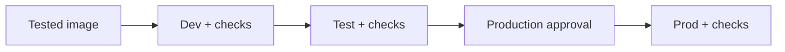

# Releases and deployment checks

How a `v*` tag promotes the image through dev, test and prod, and what to verify at each step.

## Releases

- **Upstream `v*` release:** builds, scans and publishes the application image first.
- **Company repository `v*` tag:** deploys dev, then test, then prod.
- **Prod:** needs an approver. Cannot run unless dev and test passed in the same run.
- **`LAST_ENVIRONMENT`:** repository variable. Set to `dev` or `test` to stop there; later environments show as skipped.
- **Image source:** the configured image, or your own image when the repository variable `AZURE_CONTAINER_REGISTRY` is set. The workflow builds, scans and pushes it to your Azure Container Registry.
- **Failed deployment or check:** stops promotion.
- **Production approval:** requires the GitHub environment protection described in [Bootstrap and secrets](bootstrap-and-secrets.md).

## Deployment checks

### Network facts

- The supplied Azure stack uses a Container Apps HTTPS hostname with Entra sign-in.
- Postgres has no public access. Apps reach it through a private endpoint in the stack's own VNet.
- Internal ingress, Postgres in a company network, custom domains and provided certificates need infrastructure integration. See [Client networking](../networking.md).
- Configure rate limits at your Azure gateway/WAF.

### Checklist

1. In dev, before promotion, validate Easy Auth claims, worker callback routing, managed identities, secret mounts, queue scaling, media access and tracing.
2. Run the current image scan.
3. Run an approved real generation with your organization's model deployments.
4. Check the listener and creator flows on your supported browsers and devices, including background playback where required.
5. In test, repeat the acceptance checks with the same image digest.
6. In test, exercise backup and restore procedures.
7. In test, verify alert delivery.
8. Record results and operational ownership in your private deployment workspace.

### Smoke tests

- Public smoke tests check availability, not the served version.
- Internal checks inspect the latest revision's health and image.
- Verify preview-provider permissions without silently expanding the read-only identity's access.
