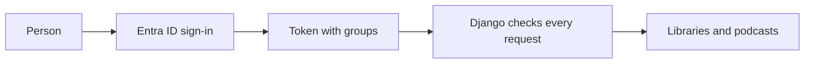

# Sign-in and access

Who can sign in through Entra ID, what each role sees, and how administrators fix access.



- **Who signs in:** everyone in the company's directory, including invited guests. Microsoft blocks anyone else.
- **No library access:** the person signs in and sees no libraries.
- **Azure:** trusts Easy Auth's authenticated identity.
- **Local:** Entra sign-in validates tokens directly, using real Entra tokens. The configured admin group controls administrator access in every environment.
- **Unauthorized requests:** return 404.
- **Anonymous protected requests:** go to sign-in.
- **Error pages:** standalone, with no app UI loaded.

## Roles

| Role | How assigned | Can do |
|---|---|---|
| Viewer | Default for new users | See ready podcasts through their owning library or an administrator's sharing grant |
| Creator | Assigned per library by an administrator in the admin | Viewer access, plus drafts and management actions in the libraries they create in |
| Administrator | Member of the configured Entra admin group, or the local **Application administrator** flag | Manage **Libraries** and **Users**, make people creators |

- Creator libraries persist across sign-ins. A creator also needs current membership of the library's Entra group.
- Administrators are labelled **Administrator**.
- Podcasts are unavailable while their owning library is not enabled.
- Library membership and creators: see [libraries and creators](#libraries-and-creators).
- The admin uses Django's standard layout. Run results and **Activity** are read-only.

## Account status

- **Active:** Django's `User.is_active` flag, editable under **Admin → Users**. New accounts default to active.
- Identity or group synchronization never reactivates a disabled user.
- Inactive accounts are refused on each protected request, including requests with an existing session.

## Unauthenticated surfaces

Only these are reachable without signing in:

- Sign-in and OAuth endpoints
- Static assets
- Health

Worker callbacks require their separate bearer credential.

## Libraries and creators

When a member signs in, each group in their token appears under **Admin → Libraries / Entra groups**, named after its Entra group ID and set to **Hidden**.

1. Open the group.
2. Change the name.
3. Set the status to **Enabled**.

- Filter by status, or search by name or ID.
- For a group nobody has signed in with yet, use **Add library** with its Entra group ID.
- With `groupClaims: ApplicationGroup`, also assign the group to the application, or its members' tokens will not list it.
- Names are labels. Access always uses the Entra group ID.

| Library status | In the portal |
|---|---|
| **Hidden** | Nobody can use it: pages, media and shares return 404 for everyone, including administrators. All data is kept; restoring is one status change. Runs already in progress still finish |
| **Enabled** | Available to members and administrators |

- Administrators get every enabled library in the portal.
- Admin list sidebars offer the first 50 enabled libraries. Each library's page links to its people and podcasts.
- Published podcasts shared into a library count as its content.

> **Note:** After rolling back to a release before this one, podcasts created in new groups stay hidden once you upgrade. Filter by **Hidden**, sort by **Owned**, then enable those libraries.

Visibility in an enabled library:

| Enabled library | Viewer | Creator in that library | Administrator |
|---|---|---|---|
| Has podcasts visible to that person | Published podcasts | Drafts and published podcasts | Drafts and published podcasts |
| Empty | Hidden | Visible | Visible |

Library access comes from Entra groups alone. To give someone a library, add them to its Entra group.

- **Admin → Users → the person → Creator in libraries** makes that person a creator in the chosen libraries. **Admin → Libraries / Entra groups → the library → Creators** does the same from the library's side.
- People who were creators before creators were assigned per library become creators in the enabled libraries they had access to.
- Creator changes are audited.
- Local library access records from earlier releases stay in the database but no longer give access.

## Group overage

Entra omits the group list from a token when a person is in too many groups, and sends an overage indicator instead.

- Microsoft documents 200 groups for these tokens, and about 5 for ID tokens from the implicit part of a hybrid flow.
- The person can still sign in. The application never follows URLs from the token.

With `isa9000:graphGroups: true`, the application asks Microsoft Graph for every signed-in person's security groups, not only after an overage.

- It uses their own sign-in and the delegated `User.Read` permission.
- It checks that the access token belongs to the signed-in person.
- It reads the list again every five minutes, two calls each time, so a membership change in Entra applies within five minutes.
- The list works like a token's list, including for library access and the administrator group.
- It is off by default.

Turn it on in this order:

1. Deploy with the setting off. With `authApp: create`, this declares the delegated Microsoft Graph permissions `openid`, `profile`, `email` and `User.Read` on the sign-in registration. With an existing registration, add them yourself.
2. Have an Entra administrator grant admin consent on each environment's registration, under **App registrations → API permissions**.
3. Set `isa9000:graphGroups: true` and deploy. It applies from each person's next sign-in. The web app must reach `graph.microsoft.com`.

> **Warning:** Grant consent before step 3. The permissions are requested at every sign-in, so without consent Microsoft can stop every employee on its own approval page.

To undo it, set the value to `false` and deploy.

If the setting is off or a lookup fails:

- The person sees a notice with a reference ID.
- A failed lookup is tried again after a minute. Until then the last list read in that session stays in use.
- Their last known memberships are kept for diagnosis only and grant nothing.
- To fix: turn on `isa9000:graphGroups`, or use `groupClaims: ApplicationGroup` so tokens list fewer groups. **Admin → Users** finds affected people with the **Directory membership** filter.
- A token with a missing or unreadable group list gets the same notice and makes no Graph call.
- An explicit empty list is a complete answer: that person has no Entra libraries.

`groupClaims` options:

| Value | Sends | Effect |
|---|---|---|
| `SecurityGroup` (default) | Each person's security groups | Groups appear in the admin |
| `ApplicationGroup` | Only groups assigned to the application | Reduces overage, subject to Microsoft's licensing and nesting limits. Other groups never appear in the admin |

With `graphGroups`, a person whose token overflows still gets all their security groups from Graph.

## Administrator access and recovery

A person is an administrator while either is true:

- Their token lists the configured administrator group.
- Their **Application administrator** flag is set under **Admin → Users**.

- Both are checked on every request. A change applies on the next request, not the next sign-in.
- An administrator affected by overage needs `isa9000:graphGroups` or the flag.
- Administrators can set the flag and **Active** for other people but not for themselves. Changes are audited.
- Suspended people stay blocked whatever their flag.

### Break-glass recovery

If nobody can reach the admin, an operator with access to the web container can restore one identity. The command needs this deployment's tenant ID and the person's Entra object ID, and works before their first sign-in.

`az containerapp exec` needs an interactive terminal and cannot pass arguments through `--command`.

1. Open a shell in the web container:

   ```bash
   az containerapp exec --resource-group YOUR-GROUP --name YOUR-WEB-APP --command sh
   ```

2. Inside that shell, grant administrator access:

   ```bash
   python manage.py app_admin grant --tenant TENANT-ID --object-id OBJECT-ID
   ```

3. Add `--activate` to also reactivate a suspended account.
4. Use `app_admin revoke` the same way to remove access.

Activity shows these changes as **Operator command**.

### Session timeouts

| Setting | Value |
|---|---|
| Idle timeout | 2 hours |
| Absolute limit | 8 hours |
| Easy Auth cookie lifetime | 8 hours, set by the Azure template. Applying it requires the normal approved deployment |

- Successful navigation/actions and CSRF-protected playback/activity heartbeats update the idle timestamp.
- JSON progress polling and idle tabs do not.
- The heartbeat is included on portal, admin and saved podcast pages.
- Local Entra sessions keep the MSAL token cache on the server and refresh expired ID tokens. Signature, issuer, audience, tenant and identity are still verified.
- Expired or unrefreshable credentials require sign-in.
- Fake sessions follow the same timeouts.
- Microsoft policy can end a session earlier.

See [Create and listen](../using.md#staying-signed-in).
